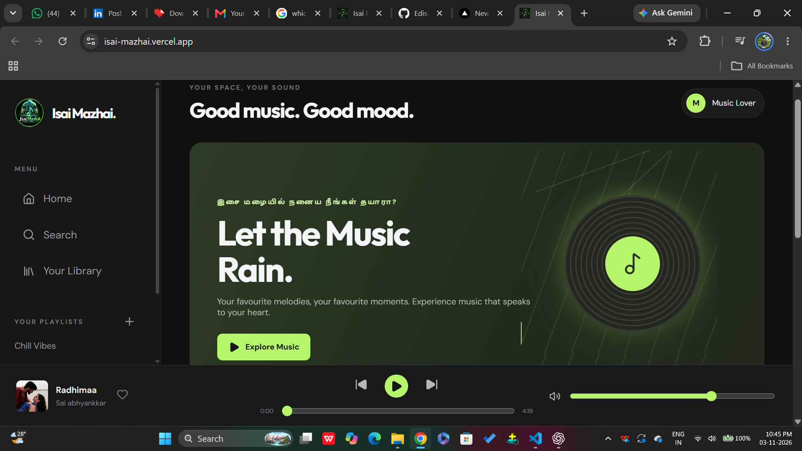
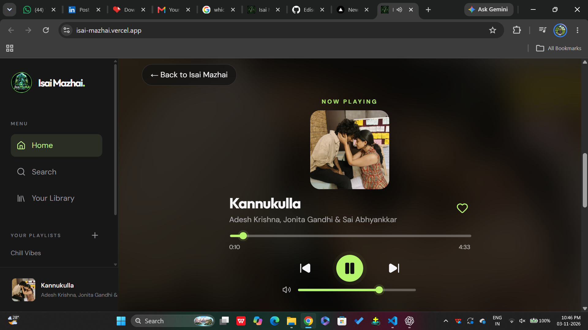
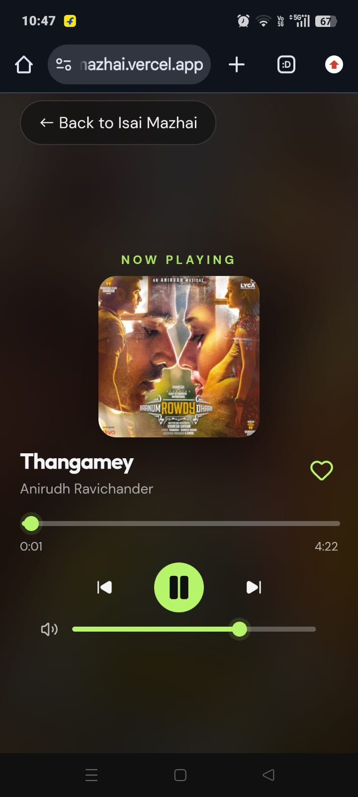

# 🎧 Isai Mazhai | இசை மழை

### இசை மழையில் நனைய நீங்கள் தயாரா?

**Let the Music Rain.**

Isai Mazhai is a React-based music player application designed to provide an enjoyable music-listening experience through a clean interface, album artwork and interactive playback controls.

**Created with ❤️ by Edison**

---

## 🌐 Live Demo

Experience Isai Mazhai here:

### [🎵 Open Isai Mazhai](https://isai-mazhai.vercel.app/)

## 📸 Screenshots

### Home Page



### Full-Page Music Player



### Mobile View



---

## ✨ Features

* 🎵 Play and pause music.
* ⏭️ Next and previous track controls.
* 🎚️ Volume control.
* ⏱️ Song progress bar with seeking functionality.
* ❤️ Like and unlike favourite songs.
* 💾 Save favourite songs using browser Local Storage.
* 🔍 Search songs by title or artist.
* 🖼️ Album artwork for each song.
* 🎧 Full-page music player.
* 🌧️ Blurred album artwork background.
* ✨ Animated user interface.
* 📱 Mobile-friendly responsive layout.

## 🛠️ Technologies Used

* React.js
* JavaScript
* HTML5
* CSS3
* Vite
* Lucide React
* Browser Local Storage

## 📂 Project Structure

```text
isai-mazhai/
│
├── public/
│   ├── songs/
│   ├── covers/
│   ├── favicon.svg
│   ├── isai-mazhai-logo.png
│   └── isai-mazhai-favicon.png
│
├── src/
│   ├── assets/
│   ├── App.jsx
│   ├── App.css
│   ├── index.css
│   └── main.jsx
│
├── docs/
│   └── screenshots/
│
├── .gitignore
├── eslint.config.js
├── index.html
├── package.json
├── package-lock.json
└── README.md
```

## ⚙️ Installation and Setup

### 1. Clone the repository

```bash
git clone https://github.com/Edison-builds/isai-mazhai.git
```

### 2. Navigate to the project folder

```bash
cd isai-mazhai
```

### 3. Install dependencies

```bash
npm install
```

### 4. Start the development server

```bash
npm run dev
```

### 5. Create a production build

```bash
npm run build
```

## 🎼 Music and Artwork

The application uses audio files and album artwork stored inside the `public` directory.

Distribution of included music and artwork is subject to the relevant permissions.

## 💡 Project Purpose

This project was developed to practise React development, component-based UI design, state management, event handling and audio playback functionality.

## 👨‍💻 Developer

**Edison**

Created with ❤️ and music.

---

**Isai Mazhai — இசை மழை**

*Let the Music Rain.*
